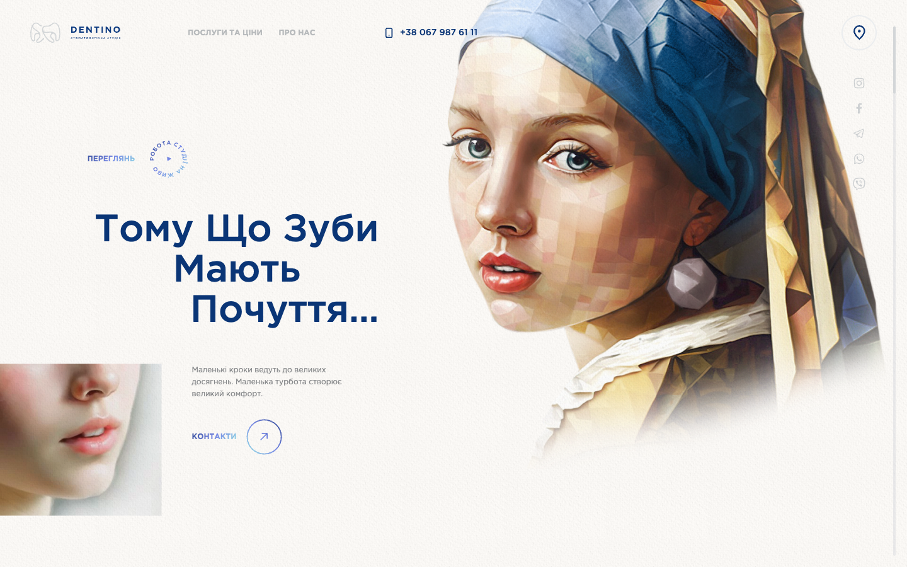
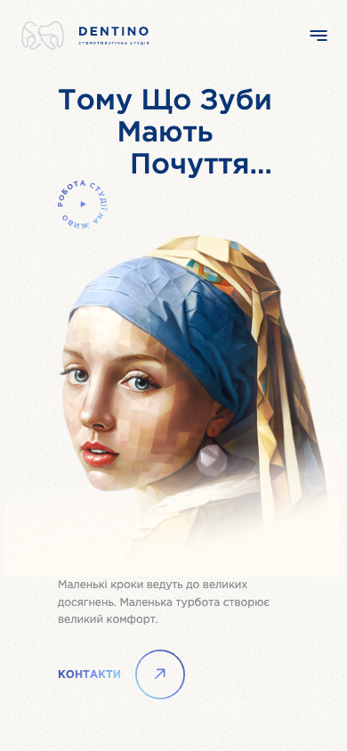
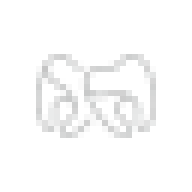
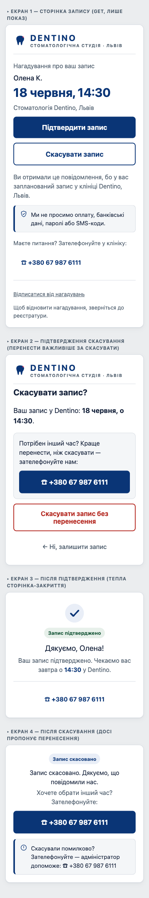
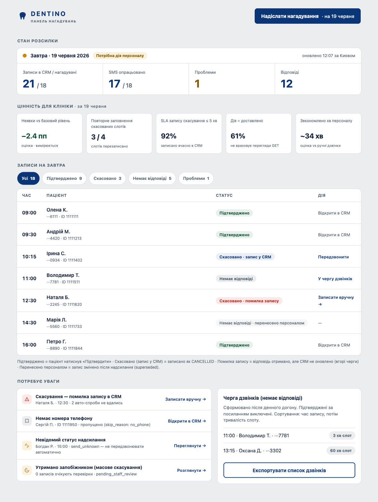

# Dentino Reminder-UI — Design System

> **Visual source of truth** for the two reminder-UI surfaces: the public confirm/cancel page
> (`supabase/functions/confirm`) and the staff dashboard (`apps/dashboard`).
> Companion machine-readable tokens: [`design-tokens.json`](./design-tokens.json).
> Governing decision: **ADR-022 — extract the brand, re-implement inline** (never import the
> live site's CSS/fonts/CDN). Builds on ADR-014 / §5.2 / §6.3 / §6.5 of the research doc.

- **Source:** `https://dentino.com.ua` — WordPress (theme `bamboo`, LiteSpeed cache), `lang="uk"`.
- **Recon date:** 2026-06-18
- **Method:** Playwright MCP `getComputedStyle` extraction (exact hex/px values — nothing eyeballed) + in-browser WCAG-2.x contrast measurement. Live site may restyle later; this captures the brand as of the recon date.

---

## 1. Brand essence (what we are honouring)

Dentino presents as a **calm, premium, navy-and-white dental studio** with generous whitespace,
a flat (shadow-light) aesthetic, and a warm, human voice. The signature is a **single deep navy**
(`#0A3576`) carried across the wordmark, headings, CTAs and the hero block, with a **sparing rose
accent** (`#F23A5B`) and cool-grey neutrals. The clinic self-describes as
*«стоматологічна студія»* and leads with an emotive tagline — *«Тому що зуби мають почуття…»*
("Because teeth have feelings…"). It already foregrounds the **clinic phone as a navy CTA pill**
in its top nav — direct precedent for our `tel:` treatment.

| Reference | |
|---|---|
| Desktop hero |  |
| Mobile hero |  |
| Brand mark (`group-11`, re-traced) |  |

*Reference screenshots only — **never shipped** on the confirm page.*

---

## 2. Palette (measured, with contrast ratios)

All ratios are WCAG-2.x, measured in-browser on 2026-06-18. **Text pairs must be ≥ 4.5:1.**

### Brand & ink

| Token | Hex | Role | Contrast (on white) | AA text |
|---|---|---|---|---|
| `brand.primary` | **`#0A3576`** | Navy — wordmark, headings, the large date/time, Confirm fill, links | **11.77:1** | ✅ |
| `brand.secondary` | `#708AB2` | Muted blue — decorative / secondary accents | 3.0:1 | decorative only |
| `brand.accent` | `#F23A5B` | Rose — **decorative accent only** (logo sparkle, hairlines) | 3.80:1 | ❌ → decorative |
| `text.default` | **`#14213A`** | Body / default ink | **16.05:1** | ✅ |
| `text.muted` | **`#51606F`** | Secondary / helper text | **6.46:1** | ✅ |
| `text.onBrand` | `#FFFFFF` | Text on navy fills | **11.77:1** (on `#0A3576`) | ✅ |

### Surfaces

| Token | Hex | Role |
|---|---|---|
| `surface.bg` | `#FFFFFF` | Page background (confirm page) |
| `surface.bgWarm` | `#FFFDFA` | Optional warm-white page tint |
| `surface.subtle` | `#EBEDEF` | Section / dashboard background, quiet panels (`#F4F6F8` lighter variant) |
| `surface.card` | `#FFFFFF` | The receipt card |
| `surface.border` | `#D7DCE3` | Hairline borders (supplementary — never the sole boundary of a control) |

### Action / state colours

| Token | Fill | Text | Pairing ratio | Use |
|---|---|---|---|---|
| **Confirm** | `#0A3576` | `#FFFFFF` | **11.77:1** | Primary, one-tap, filled, first position |
| **Cancel** | `#FFFFFF` | `#0A3576` (2px navy border) | **11.77:1** | Secondary **outline**, second position → interstitial |
| **Destructive** | `#FFFFFF` | `#B3261E` (border `#B3261E`) | **6.54:1** | Only the interstitial's *«Скасувати без перенесення»* |
| **Reschedule call** | `#0A3576` | `#FFFFFF` | **11.77:1** | Foregrounded `tel:` CTA in the interstitial |
| **Success** | `#0F5132` text / `#E7F0EA` tint | — | **9.36:1** | Post-confirm closure, dashboard "Підтверджено" |
| **Focus ring** | `#0A3576`, 3px, offset 2px | — | 11.77:1 | Visible keyboard focus everywhere |

> **Confirm vs Cancel are distinguished by FILL + POSITION + LABEL, never colour alone**
> (ADR-014 / §5.2 / §6.5). The danger hue on the final destructive button is a *supplementary*
> cue layered on an explicit label — not a red/green colour code.

---

## 3. Typography

**Stack (Cyrillic-complete system fonts — no webfonts):**

```
system-ui, -apple-system, "Segoe UI", Roboto, "Helvetica Neue", Arial, "Noto Sans", "Liberation Sans", sans-serif
```

- **Substitutes** the site's self-hosted **Gotham Pro / Gotham Pro Medium / Gotham Pro Bold** (`.woff2`).
  Gotham is a geometric grotesque; every stack member (San Francisco, Segoe UI, Roboto, Noto Sans)
  is a clean neutral sans with **complete Ukrainian-Cyrillic** coverage on its native OS — so the
  page renders correctly on iOS, Windows, and (critically) low-end Android, with zero font download.
- **Base 18 px**, line-height **1.5**. Scale: `14 · 16 · 18 · 22 · 28 · 32`. Weights `400 / 500 / 700`.
- **The appointment date/time is the largest element — 32 px, bold navy, real text** (constraint 7).
  *(The marketing site uses a 12 px desktop base; the confirm page deliberately resets to an 18 px
  accessible base.)*
- **Wordmark tracking:** the brand's "DENTINO" is wide-tracked caps (`≈0.18em`); we preserve that feel
  in the inline-SVG/text lockup.

---

## 4. Logo treatment

- The live "DENTINO" is **letter-spaced bold navy text**, paired with a **tooth line-mark**
  (favicon `group-11`) and a tiny grey sub-label *«СТОМАТОЛОГІЧНА СТУДІЯ»*. There is **no clean vector
  wordmark to scrape** and the favicon is raster — so we **re-traced** the mark.
- [`assets/logo.svg`](./assets/logo.svg) — an inline-ready lockup: re-traced tooth glyph (navy) +
  rose sparkle accent + "DENTINO" + studio sub-label. Self-contained, no external refs.
- **On the confirm page** the header renders an **inline `<svg>` tooth mark** (decorative,
  `aria-hidden`) beside the wordmark set as **real styled text** — the most zoom- and
  screen-reader-robust treatment, and faithful to how the site itself renders the name.
- **Favicon:** production serves a same-origin tooth icon (or `204`); the mockup ships **no favicon
  link** so the artifact stays provably zero-external-request.
- **Owner-provided (2026-06-19):** the official vector logo is now in
  `assets/Dentino-logo-black.{ai,eps,pdf}` and `assets/Dentino-logo-white.{ai,eps,pdf}` (both **black**
  and **white**, 1-page vectors). The real mark is a **two-tooth line-art glyph** above a wide-tracked
  **"DENTINO"** wordmark with **«СТОМАТОЛОГІЧНА СТУДІЯ»** and a **"BY RAK & RAK"** sub-line —
  **monochrome, no rose accent in the mark itself.** At confirm-page build time it replaces the
  re-traced `logo.svg` — extracted to inline SVG (no external assets — ADR-022), using the **black**
  version recoloured **navy `#0A3576`** for white-background surfaces and the **white** version for any
  dark surface. *(The earlier re-trace used a single tooth + rose sparkle; the official two-tooth mark
  supersedes it — the re-trace stays as a fallback.)*

---

## 5. Components & spacing tokens

| Token | Value |
|---|---|
| Spacing scale | `4 · 8 · 12 · 16 · 24 · 32` px |
| Radius — card | `12 px` |
| Radius — button | `8 px` (matches the site's predominant 8 px radius) |
| Radius — pill/badge | `999 px` |
| Button height | `56 px` primary · **≥ 48 px** all tap targets · full-width on narrow screens |
| Page max-width (confirm) | `480 px` |
| Shadow | site is flat; confirm/dashboard cards use **one** very soft shadow to lift the card on low-end screens |
| Buttons | Primary = solid navy fill; Secondary = navy outline; Destructive = danger outline; Ghost = text-only |
| Links | navy `#0A3576`, underline on the opt-out; `tel:` links are first-class one-tap targets |

### `:root{}` inline-CSS seed (the engine's confirm-page + dashboard theme)

```css
:root{
  --brand:#0A3576; --brand-2:#708AB2; --accent:#F23A5B;
  --bg:#FFFFFF; --bg-warm:#FFFDFA; --card:#FFFFFF; --subtle:#EBEDEF; --border:#D7DCE3;
  --ink:#14213A; --muted:#51606F; --on-brand:#FFFFFF;
  --danger:#B3261E; --success:#0F5132; --focus:#0A3576;
  --r-card:12px; --r-btn:8px;
  --stack:system-ui,-apple-system,"Segoe UI",Roboto,"Helvetica Neue",Arial,"Noto Sans","Liberation Sans",sans-serif;
}
```

---

## 6. Voice & tone (Ukrainian)

- **Register:** formal **«Ви»** (healthcare convention; matches the §9.3 copy seeds).
- **Warm + calm + concrete.** The clinic's own voice is emotive ("teeth have feelings"); on the
  confirm page we keep warmth but stay in **bank-confirmation-receipt** register — no marketing copy,
  no prices, no clinical detail (§6.3). Names the clinic plainly: *«Стоматологія Dentino, Львів»*.
- The **anti-scam line** *«Ми не просимо оплату, банківські дані, паролі або SMS-коди.»* is a trust
  lever (NBU-grounded), styled as a quiet reassurance note, never an alarm.

---

## 7. Mockups (the review artifacts)

| Surface | File | Render |
|---|---|---|
| Public confirm/cancel page (4-state storyboard) | [`mockups/confirm-page.html`](./mockups/confirm-page.html) |  |
| Staff dashboard | [`mockups/dashboard.html`](./mockups/dashboard.html) |  |

The confirm-page storyboard depicts: **(1)** appointment page → **(2)** reschedule-first cancel
interstitial → **(3)** post-confirm closure → **(4)** post-cancel closure. The grey *«▸ Екран …»*
chips are review annotations; the real page renders one card at a time.

---

## 8. Compliance adaptations (live brand → constraint-compliant)

Every place the captured brand was **changed** to satisfy the confirm page's hard constraints
(no third-party assets · AA contrast · no-JS · ≤ 50 KB). This is the brand-fidelity audit trail.

| # | Live brand | Problem | Adaptation (shipped) |
|---|---|---|---|
| 1 | **Gotham Pro** webfonts (`.woff2`) | Webfont = third-party asset; download cost on low-end Android | Substituted with the **Cyrillic-complete system-font stack**; wordmark tracking preserved |
| 2 | Muted grey **`#8B8D8F`** body text | On white = **3.33:1 → fails AA** | Darkened to **`#51606F` (6.46:1)** for all muted/helper text |
| 3 | Rose accent **`#F23A5B`** | On white = **3.80:1 → fails AA** for text | Kept **decorative only** (logo sparkle / hairline; passes the 3:1 non-text bar). `#C32847` (5.65:1) is the legible-text fallback if ever needed |
| 4 | Confirm/Cancel as colour-coded | Colour-alone signalling fails colour-blind users | **Fill + position + label** differentiate them (filled navy Confirm above outline navy Cancel) |
| 5 | Raster/text logo + raster favicon | Can't hotlink; raster isn't crisp/inline | **Re-traced** tooth + wordmark as inline SVG/text; favicon served same-origin (not third-party) |
| 6 | Hero imagery, marketing layout, 12 px type | Heavy assets; marketing tone; sub-AA size | Dropped entirely — **calm single-card receipt**, 18 px base, 32 px date/time, generous spacing |
| 7 | Flat hairline borders (`#D7DCE3`, ~1.5:1) | Too faint to be a control's *sole* boundary | Borders kept **supplementary**; every control's legibility comes from text/fill contrast |
| 8 | Site loads external CSS/JS/fonts/images | Any external ref breaks the asset rule + leaks the URL token | Everything **inline**: inline `<style>`, inline `<svg>` (no namespace attr → zero external-URL strings), `tel:` + relative same-origin form actions only |

---

## 9. Verification snapshot (confirm-page.html — the gated artifact)

| Gate | Result |
|---|---|
| Zero third-party assets (grep `https?://` / `src=` / `@import` / `url(`) | **0 hits** ✅ |
| Runtime network requests | **1** (the document itself) ✅ |
| No JavaScript (no `<script>` / inline handlers) | **0** → JS-disabled behaviour identical ✅ |
| HTML+CSS gzipped | **≈ 4.4 KB** (≤ 50 KB) ✅ |
| `lang="uk"` · no `user-scalable=no` · no `maximum-scale` | ✅ |
| Every text/Confirm/Cancel pair ≥ 4.5:1 | min **6.46:1** ✅ |
| Tap targets ≥ 48 px (primary 56 px), full-width | ✅ |
| Date/time largest, real text (32 px) | ✅ |
| Logo = inline SVG, no external reference | ✅ |

*The deterministic CI gates (axe-core contrast, JS-disabled form POST, throttled low-end-Android,
200 % zoom, ≥48 px device emulation) run later under Playwright `@playwright/test` per §6.5, using
this mockup as the fixture/seed.*
